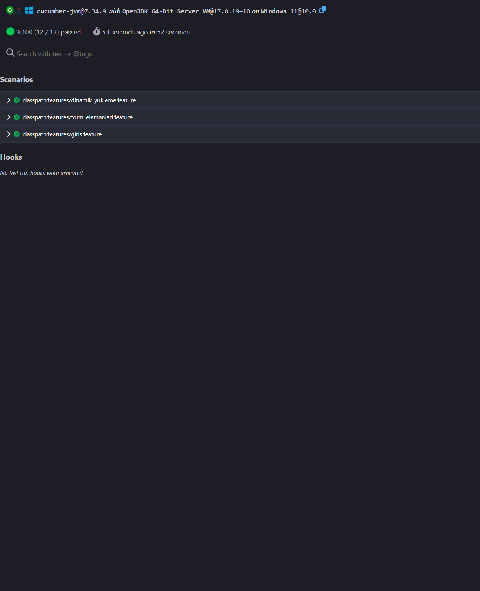

# BIL 002 · Kısım 2: Selenium + Cucumber UI Test Otomasyonu

Sakarya Uygulamalı Bilimler Üniversitesi · BIL 002 Yazılım Doğrulama ve Sınama dönem projesi, Kısım 2.
Kısım 1 (BankAccount API testleri): https://github.com/AsirCan/bil002-bankaccount-24010903086

## Seçilen site: [the-internet.herokuapp.com](https://the-internet.herokuapp.com)

**Neden bu site?**
- Test otomasyonu pratiği için yapılmış, herkese açık ve **kararlı** bir site (Elemental Selenium / Sauce Labs).
- CAPTCHA, 2FA ya da gerçek ödeme yok. Demo hesap sayfada açıkça veriliyor (`tomsmith` / `SuperSecretPassword!`).
- **Dinamik yükleme** sayfaları explicit wait'in neden gerekli olduğunu göstermek için birebir.
- Çok kişinin seçeceği e-ticaret demo sitelerinden farklı, senaryolar özgün.

**Test edilen akışlar (3 sayfa grubu, 3 feature, 10 senaryo / 12 koşum):**

| Feature | Sayfa | Senaryolar | Tür |
|---|---|---|---|
| `giris.feature` | `/login`, `/secure` | Geçerli giriş · hatalı girişler (**Scenario Outline**, 4 örnek) · çıkış | pozitif + negatif |
| `dinamik_yukleme.feature` | `/dynamic_loading/1`, `/2` | "Hello World!" yükleme sonunda görünür (**Scenario Outline**, 2 örnek) | pozitif |
| `form_elemanlari.feature` | `/dropdown`, `/checkboxes` | Seçenek seçme (**Scenario Outline**) · yer tutucu seçilemez · onay kutusu durumu | pozitif + negatif |

## Yapı (Page Object Model)

```
src/test/java/tr/edu/sakarya/bil002/selenium/
├── pages/      TemelSayfa (ortak explicit wait), GirisSayfasi, GuvenliAlanSayfasi,
│               DinamikYuklemeSayfasi, FormElemanlariSayfasi      ← locator'lar SADECE burada
├── steps/      GirisAdimlari, DinamikYuklemeAdimlari, FormElemanlariAdimlari
│               ← driver.findElement YOK, sadece page metotları çağrılır
├── destek/     TarayiciBaglami (sürücü, headless), Kancalar (@After: hata anında ekran görüntüsü + kapatma)
└── runner/     CucumberTestRunner (@Suite + @SelectClasspathResource("features"))
src/test/resources/features/   *.feature (Türkçe Gherkin: # language: tr)
```

- **Bekleme stratejisi:** Bütün beklemeler `WebDriverWait` + `ExpectedConditions` (en fazla 10 sn). `Thread.sleep` ve implicit wait **yok**.
- **Bonuslar:** Başarısız senaryoda ekran görüntüsü (rapora eklenir ve `target/ekran-goruntuleri/` altına yazılır) · headless parametresi · GitHub Actions'ta headless Chrome · Cucumber HTML raporu.

## Çalıştırma

Gereken: JDK 17 ve Google Chrome. Chromedriver'ı Selenium Manager otomatik indirir.

```
./mvnw test                     # varsayılan: headless (ekransız) Chrome
./mvnw test -Dheadless=false    # tarayıcıyı görerek çalıştır
```

Windows'ta `mvnw.cmd test`. Rapor: `target/cucumber-rapor.html`.


